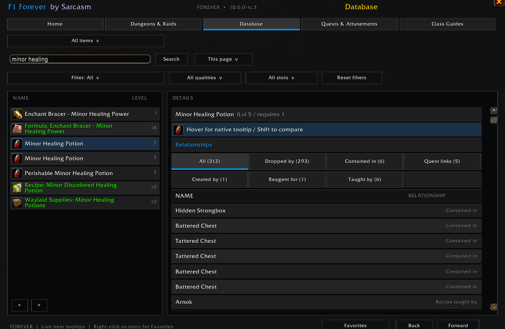
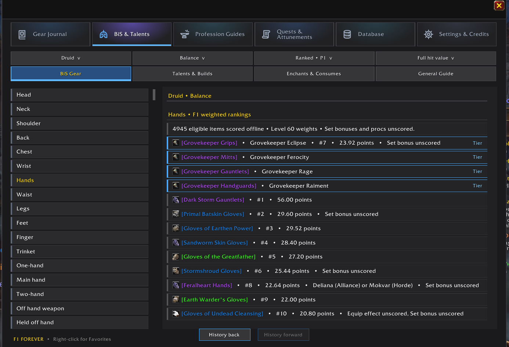

# F1-Forever — an in-game WoW database

Hover an item, NPC or quest and press **F1**. F1-Forever opens a Wowhead-style database inside World of Warcraft: Forever. Follow a drop to its boss, a recipe to its vendor, or a dungeon quest back to the step you still need.

**[Install F1-Forever on CurseForge](https://www.curseforge.com/wow/addons/f1-forever)** · [10.1.4 release notes](CHANGELOG.md)

## What can the Forever client tell us about an item?

F1-Forever reads items directly from the running game. When the client resolves an item link, our probe records the item ID, the stats the client returns, and the tooltip text for effects such as **Use**, **Equip** and **Chance on hit**. We save the client build with the observation so we can check what changed after a patch. On hover, the addon can also compare the item's readable stats with your equipped gear using weights for your spec.

We cross-check those observations against existing databases and item caches. Missing entries, newly discovered items and conflicting values are what we investigate by hand: we look up the exact item ID in game, inspect its tooltip and compare what it says with the saved record. If the client can't resolve the item, the check stays open.

One example from testing was the **Ring of Critical Testing**. Its in-game tooltip showed **+50% critical strike chance**, and our Wowhead Forever name search returned no item match. We could verify exactly what the ring said in that client build. Whether players can obtain it is a separate question that needs a confirmed source.

## Looking for a Wowhead DB or WowDB alternative?

If you usually tab out to answer “Where does this come from?”, start with the same item in game. Search by name or ID, then follow its recorded connections. For a recipe, that can mean checking what it makes, which reagents it needs, who sells or teaches it, and where to find that NPC. Locations with recorded coordinates can open a map pin. Coverage varies by item and faction.

## Is this drop worth rolling on?

Choose your spec and slot under **BiS & Talents**. The 10.1.4 release ranks up to ten items per slot using Forever item stats and WoWSims weights. Toggle between full hit value and already capped. Blue-bordered rows also surface crafted tier pieces. Consider their set bonuses separately when choosing what to wear.

## What do I need before this dungeon?

Open **Gear Journal**, choose a dungeon and expand a quest. The chain shows completed steps and the quest currently in your log. The Profession Guides cover recipes, reagents and recorded trainers or vendors.

## Install and open

Install the Forever edition from the CurseForge link above and enable **F1 Forever** at character selection. Type **/f1** to open the browser. If another action uses F1, open **Settings & Credits** to change the binding.

## Repository contents and credits

The [Lua source](F1Forever/) contains the browser UI, relationship lookup, item probing and tooltip comparison modules from the shipped 10.1.4 release. The installable addon, including generated data tables, guides and artwork, is distributed on CurseForge. GitHub's **Download ZIP** provides this source snapshot.

F1-Forever is an independent addon by **Sarcasm**. Wowhead and WowDB are referenced for comparison. The project draws on Forever client data, [WoWSims Forever](https://github.com/wowsims/forever), [QuestieDB](https://github.com/Questie/QuestieDB) and [Napalmsteak's item caches](https://github.com/Napalmsteak/WoW-Classic-Item-Caches).

Found a missing source or incorrect connection? Open a GitHub issue with the item or NPC name or ID, the Forever client version, and what you observed in game.
